 

  

 

I'm **Niusha Shamsikhani**, a B.Sc. student in Industrial Engineering at **Shahid Beheshti University** (Tehran, Iran).

Through industry-facing research projects, I saw first-hand how much of real-world operations (time studies, line balancing, damage assessment) still depends on manual, error-prone processes. That pushed me toward machine learning, statistical learning, and data-driven modeling as the toolkit for fixing them. I now build end-to-end AI systems on proprietary industrial data and plan to pursue graduate research in machine learning.

> 🎯 **Looking for:** graduate research opportunities at the intersection of machine learning, data-driven modeling, and real-world industrial systems.

<table>
  <tr>
    <td align="center" width="33%">
      <h3>🏭 Industrial AI</h3>
      OCR/NLP pipelines and heuristic models that estimate assembly times from process sheets
    </td>
    <td align="center" width="33%">
      <h3>👁️ Multimodal Systems</h3>
      Vision, text, audio and video combined into automated damage assessment
    </td>
    <td align="center" width="33%">
      <h3>📊 Data-Driven Modeling</h3>
      Machine learning for assembly-line balancing and decision support
    </td>
  </tr>
</table>

 

 

 

  

<table>
  <tr>
    <td width="50%" valign="top">
      <h4>🧠 Machine Learning</h4>
      Supervised learning, regression, process classification
    </td>
    <td width="50%" valign="top">
      <h4>📐 Statistical Learning</h4>
      Statistical analysis and inference for engineering data
    </td>
  </tr>
  <tr>
    <td width="50%" valign="top">
      <h4>⚙️ Data-Driven Modeling</h4>
      Learning from process data to estimate, optimize, and decide
    </td>
    <td width="50%" valign="top">
      <h4>👁️ Deep Learning</h4>
      Computer vision and multimodal pipelines (working knowledge)
    </td>
  </tr>
  <tr>
    <td colspan="2" align="center" valign="top">
      <h4>📄 Intelligent Data Analysis</h4>
      OCR/NLP-based structuring of unstructured industrial documents
    </td>
  </tr>
</table>

 

 

 

<h3>🚗 ProStream</h3>
<b>Intelligent Automotive Assembly Process & Time-Estimation Platform</b> · <i>Aug 2024 – Present</i>
 
Industry collaboration with an automotive manufacturer · Role: Technical Lead

  

  

  

  

<h3>🛠️ Intelligent Vehicle Damage Assessment & Cost Estimation</h3>
<b>Multimodal AI pipeline for damage detection and repair-cost estimation</b> · <i>Oct 2025 – Present</i>
 
Industry collaboration with an automotive after-sales and roadside-assistance provider

  

  

  

  

 

 

  

<table>
  <tr>
    <td width="50%" align="center" valign="top">
      <b>⚙️ CORE TECHNOLOGY</b>  
      
      
      
      
      
      
    </td>
    <td width="50%" align="center" valign="top">
      <b>🧠 AI & DATA SCIENCE</b>  
      
      
      
      
      
      
      
    </td>
  </tr>
  <tr>
    <td width="50%" align="center" valign="top">
      <b>🛠️ TOOLS</b>  
      
      
      
    </td>
    <td width="50%" align="center" valign="top">
      <b>🧊 3D DESIGN & VISUALIZATION</b>  
      
    </td>
  </tr>
</table>

 

 

 

  

<i>"Turning messy industrial data into decisions that work."</i> ✨

