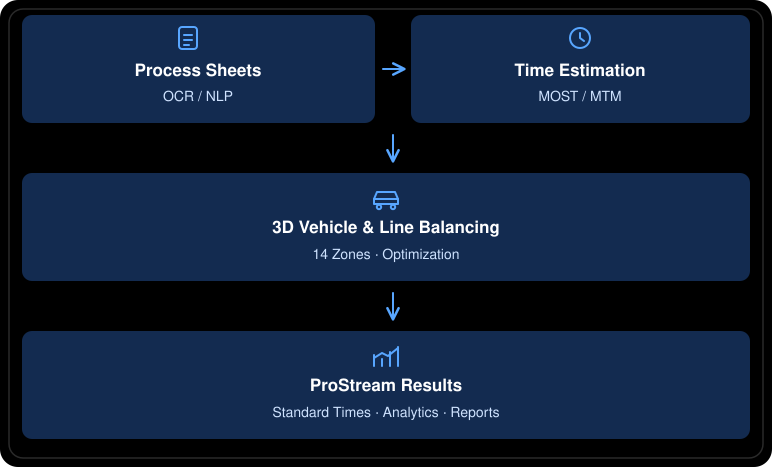
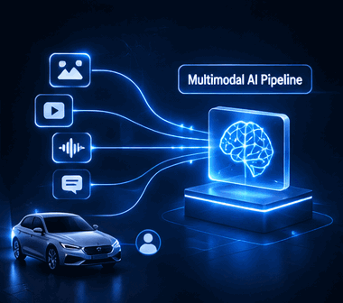

  

 

---

## 👩‍💻 About Me

I'm **Niusha Shamsikhani**, a B.Sc. student in **Industrial Engineering** at **Shahid Beheshti University** (Tehran, Iran).

Industry-facing projects showed me how much of real-world operations (time studies, line balancing, damage assessment) still depends on manual, error-prone processes. That pushed me toward **machine learning, statistical learning, and data-driven modeling**. I now build end-to-end AI systems on proprietary industrial data and plan to pursue **graduate research in machine learning**.

> 🎯 **Looking for:** graduate research opportunities at the intersection of **machine learning, data-driven modeling, and real-world industrial systems**.

---

## 🚀 Featured Projects

### 🚗 ProStream
**AI-powered assembly process & time-estimation platform** · *Aug 2024 – Present*

 

`OCR / NLP` · `BasicMOST / MTM` · `3D vehicle explorer (14 zones)` · `4–10% deviation vs. stopwatch studies`

  

### 🛠️ Intelligent Vehicle Damage Assessment
**Multimodal AI pipeline for damage detection & cost estimation** · *Oct 2025 – Present*

 

`Computer Vision` · `Multimodal AI` · `LLMs` · `Repair-vs-replace decision support`

---

## 🔬 Research Interests

---

## 💻 Skills & Tooling

<h4>Industrial Engineering · Machine Learning · Data Systems</h4>

<table>
<tr>
<td width="50%" align="center" valign="top">

### LANGUAGES & CORE

</td>
<td width="50%" align="center" valign="top">

### MACHINE LEARNING & AI

</td>
</tr>
<tr>
<td width="50%" align="center" valign="top">

### DATA & SCIENTIFIC COMPUTING

</td>
<td width="50%" align="center" valign="top">

### BACKEND & FULL-STACK

</td>
</tr>
<tr>
<td width="50%" align="center" valign="top">

### INDUSTRIAL ENGINEERING & OPTIMIZATION

</td>
<td width="50%" align="center" valign="top">

### SIMULATION & 3D VISUALIZATION

</td>
</tr>
<tr>
<td width="50%" align="center" valign="top">

### AI DEVELOPMENT TOOLS

</td>
<td width="50%" align="center" valign="top">

### CURRENTLY LEARNING

</td>
</tr>
</table>

<i>Tools are instruments · Better decisions from industrial data are the objective</i>

---

*"Turning messy industrial data into decisions that work."* ✨

 

